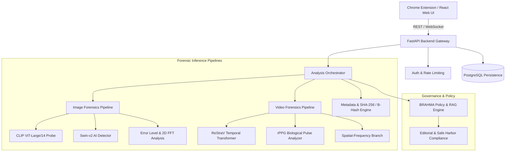

# SECURA AI 3.0 — High-Assurance Forensic Media Intelligence Platform

[](https://www.python.org/)
[](https://fastapi.tiangolo.com/)
[](https://react.dev/)
[](https://www.typescriptlang.org/)
[](https://pytorch.org/)
[](LICENSE)

Secura AI 3.0 is an enterprise-grade digital media forensics and authenticity verification platform engineered for deepfake detection, forensic provenance verification, real-time browser content shielding, and media integrity auditing.

The system combines multi-spectral computer vision, temporal transformer video forensics (ReStraV), biological pulse consistency (rPPG), cryptographic provenance (C2PA/EXIF), and the **BRAHMA (Belief, Reasoning, Auditing, Heuristic Media Assessment)** policy & RAG engine.

---

## 🏗️ System Architecture



### Key Modules:
1. **Frontend Client (`/frontend`)**: React 18, Vite, TypeScript, Tailwind CSS, Lucide icons, Canvas-based FFT/ELA visualizers, and live forensic workspaces.
2. **Backend API (`/backend`)**: FastAPI, PyTorch, Uvicorn, TorchVision, OpenCV, SciPy, NumPy, Pydantic v2.
3. **Chrome Extension (`/extension`)**: Manifest V3 Sentinel extension with on-the-fly DOM media inspection, context-menu scanning, and live security badging.
4. **BRAHMA Engine (`/backend/app/services/brahma`)**: Multi-level policy assessment, pre-publication provenance verification, and media integrity scoring.
5. **ReStraV Video Forensics (`/backend/app/services/video_branches`)**: Multi-stream video forensics analyzing temporal consistency across frames.

---

## 💻 Hardware & Software Requirements

| Component | Minimum Requirements | Recommended Specifications |
| :--- | :--- | :--- |
| **Operating System** | Windows 10/11 (64-bit), macOS 12+, Ubuntu 20.04+ | Windows 11 / Ubuntu 22.04 LTS |
| **CPU** | 4-Core Intel/AMD (x86_64 or Apple Silicon) | 8-Core Intel Core i7/i9 or AMD Ryzen 7/9 / Apple M-series |
| **RAM** | 8 GB RAM | 16 GB - 32 GB RAM |
| **GPU (Optional)** | None (Automatic CPU fallback supported) | NVIDIA RTX 3060+ (8 GB+ VRAM) with CUDA 11.8 / 12.1+ |
| **Disk Space** | 5 GB available storage | 10 GB SSD storage |
| **Runtimes** | Python 3.10 - 3.12, Node.js 18.x - 22.x, Git | Python 3.11, Node.js 20 LTS |

---

## 🚀 Quick Start: Clone and Run in 3 Steps

### Step 1: Clone the Repository
```bash
git clone https://github.com/Amiiiii7119/Secura-AI-3.0-.git
cd Secura-AI-3.0-
```

### Step 2: One-Command Automated Installation
Run the automated installer script for your operating system. This script checks your environment, sets up virtual environments, installs Python and Node dependencies, verifies model assets, and configures environment variables:

**On Windows (PowerShell):**
```powershell
.\scripts\install.ps1
```

**On Linux / macOS (Bash):**
```bash
chmod +x ./scripts/install.sh ./scripts/start.sh
./scripts/install.sh
```

### Step 3: Start Secura AI
Launch both the backend API and frontend dev server simultaneously:

**On Windows (PowerShell or Batch):**
```powershell
.\scripts\start.ps1
# or:
.\start_secura.bat
```

**On Linux / macOS (Bash):**
```bash
./scripts/start.sh
```

- **Backend API**: `http://localhost:8000` (Swagger UI: `http://localhost:8000/docs`)
- **Frontend Dashboard**: `http://localhost:5173`

---

## 🧠 AI Model Distribution & Checkpoint Verification

Secura AI adheres to modern ML packaging best practices:
- **Lightweight Custom Probes (<1 MB)** are directly version-controlled in the repository (`backend/models/weights/`).
- **Heavy Foundation Backbones (>100 MB)** such as OpenAI CLIP and Swin Transformer are automatically fetched from Hugging Face Hub during installation using `scripts/download_models.py`.

### Model Verification Manifest (`models/model-manifest.json`)
All active weights are cryptographically verified using SHA-256 checksums:

| Model ID | Relative Path | Size | SHA-256 Checksum | Redistribution |
| :--- | :--- | :--- | :--- | :--- |
| `clip_probe_v1` | `backend/models/weights/fc_weights.pth` | 4,083 B | `477100745713bcc957beb2b40859536859b6483fd6301b3b9293151b194c7847` | In Repository (Apache 2.0) |
| `custom_fc_weights` | `backend/models/weights/custom_fc_weights.pth` | 3,318 B | `501a0b8c48e0d6b4b8d3c60301106f038638a8f8cf04985b04a22e079283627f` | In Repository (Apache 2.0) |
| `clip_domain_projections` | `backend/models/weights/clip_domain_projections.npz` | 6,664 B | `8507882fcb05ef3d66bbf3d3a6bc6fe64b97a39e1983a444950be4077ab085f3` | In Repository (Apache 2.0) |
| `restrav_mlp` | `backend/models/weights/restrav_temporal/restrav_mlp.pt` | 5,509 B | `3462ad5b9ad47e2e4cd119360097c87e10d2541f3a546d87286c803d4008195f` | In Repository (Apache 2.0) |
| `restrav_mean` | `backend/models/weights/restrav_temporal/mean.npy` | 212 B | `14fd56010dc8626cb4392772dcdbc26afd3a0dedb12a3462b0371563ec8eb3b7` | In Repository (Apache 2.0) |
| `restrav_std` | `backend/models/weights/restrav_temporal/std.npy` | 212 B | `697ebeb281d197b3b962cc66e19a72596bc44d4dd88d8f56342a23fd0bf7d6f6` | In Repository (Apache 2.0) |
| `extension_image_detector` | `backend/models/weights/extension_image_detector_v1/model_weights.pt` | 859,297 B | `5ba3add8f5596b8229b6fc92b4d0c823344f7a1b1a352ab7b4bc1b5a888ae5ae` | In Repository (Apache 2.0) |

To verify models manually at any time:
```bash
python scripts/download_models.py --verify-only
```

---

## 🧩 Chrome Extension Installation

The Chrome Extension (`/extension`) allows real-time deepfake scanning on any webpage:

1. Open Google Chrome and navigate to `chrome://extensions/`.
2. Enable **Developer mode** via the toggle switch in the upper-right corner.
3. Click **Load unpacked** in the top-left toolbar.
4. Select the `extension/` directory from this repository.
5. The Secura Sentinel icon will appear in your Chrome toolbar.
6. Click the extension icon to verify backend connectivity (default: `http://localhost:8000`).

---

## 🧪 Verification & Health Checks

### 1. Pre-Flight System Audit
Verify Python, Node, database, and model readiness:
```bash
python scripts/verify_setup.py
```

### 2. Backend Health Endpoint
```bash
curl http://localhost:8000/api/health
```
Expected response:
```json
{
  "status": "healthy",
  "app_name": "Secura AI",
  "environment": "development",
  "ai_detector": "active",
  "device": "cpu"
}
```

### 3. Test Image Detection API
```bash
curl -X POST "http://localhost:8000/api/analyze/image" \
  -H "accept: application/json" \
  -H "Content-Type: multipart/form-data" \
  -F "file=@frontend/public/benchmark_images/sample_real.png"
```

### 4. Run Pytest Suite
```bash
pytest backend/tests/ -v
```

---

## 📁 Repository Structure

```
Secura-AI-3.0-/
├── backend/                        # FastAPI Inference Engine
│   ├── app/
│   │   ├── api/                    # REST API routes (analyze, auth, brahma)
│   │   ├── core/                   # Security, config, database session
│   │   ├── models/                 # SQLAlchemy ORM schemas
│   │   ├── schemas/                # Pydantic request/response models
│   │   └── services/               # Inference pipelines, ELA, FFT, video fusion
│   ├── models/
│   │   ├── model-manifest.json     # Cryptographic weight manifest
│   │   └── weights/                # Lightweight custom ML probe weights
│   └── tests/                      # Automated regression and inference tests
├── frontend/                       # React 18 + Vite Web Application
│   ├── src/
│   │   ├── components/             # Forensic workspaces, visualizers, dashboards
│   │   ├── services/               # API clients, export engines
│   │   └── types/                  # TypeScript interface contracts
│   └── package.json
├── extension/                      # Chrome Extension (Manifest V3 Sentinel)
│   ├── manifest.json
│   ├── popup.html / popup.js
│   ├── sentinel.js
│   └── content.js
├── models/
│   └── model-manifest.json         # Root-level mirror manifest
├── scripts/                        # Reproducibility & Automation Tooling
│   ├── install.ps1 / install.sh    # One-command installer
│   ├── start.ps1 / start.sh        # One-command application launcher
│   ├── download_models.py          # Weight downloader & SHA-256 verifier
│   └── verify_setup.py             # Pre-flight diagnostic checker
├── .env.example                    # Environment template with zero secrets
└── README.md                       # Comprehensive guide
```

---

## 🔒 Security & Safe Operation

- **No Hardcoded Secrets**: Secrets and database credentials must be provided via local `.env`.
- **NIST-Compliant Passwords**: PBKDF2-HMAC-SHA256 password hashing.
- **Rate-Limiting**: Sliding-window limiter on authentication and inference endpoints.
- **Fail-Safe Inference**: Comprehensive error handling that distinguishes network timeouts from true deepfake detections.

---

## 📜 License & Acknowledgments

- **Secura AI Source Code**: Apache License 2.0.
- **Upstream Models**:
  - OpenAI CLIP (MIT License)
  - Microsoft Swin Transformer (Apache 2.0)
  - Hugging Face Transformers (Apache 2.0)

Built for high-assurance digital authenticity verification.
